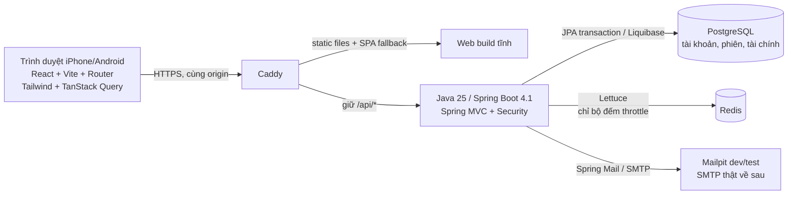
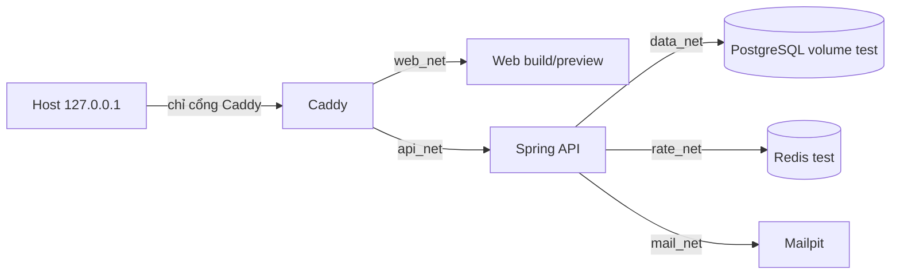
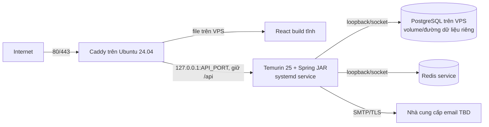

# Sơ đồ kiến trúc Java/Spring đề xuất cho CapMoney

**Status: PROPOSED, ngày 14/10/2026.** Bản này triển khai cách hiểu kỹ thuật từ [TS10–TS38](../../docs/requirements/tech-stack-round-2.md) và [ADR 0003 đề xuất](../../docs/adr/0003-java-spring-and-deployment.md). [Reviewer Tech độc lập đã kiểm lại ba P1 ở mức ADR](java-tech-review.md); kết quả đó **chưa** cấp `TECH_READY` cho [INFRA-01/#47](story.md) hoặc CM-01/#43. [Thiết kế triển khai INFRA Java](technical-design-java.md) đang chờ review Tech/PM riêng. [Sơ đồ Node/Hono cũ](architecture.md) chỉ là lịch sử.

## Luồng request và nơi giữ dữ liệu

Ninh đã chọn các thành phần chính; **Tech đề xuất** đường đi cùng origin, phân quyền ở API và PostgreSQL làm nguồn sự thật của phiên/JWT revocation. Redis không giữ số dư, ví hay danh sách JWT được phép. Cookie access JWT 15 phút và refresh JWT 7 ngày `HttpOnly`/`Secure`; state DB được kiểm trên mỗi request có quyền để đáp ứng thu hồi ngay. Origin và CSRF được kiểm cho thao tác đổi trạng thái. `fetch` cần gửi cookie cùng origin, nhận 401/403/429 rõ ràng; TanStack Query chỉ cache dữ liệu đã phân quyền trong phiên trình duyệt và xóa cache khi logout/đổi người. Không có offline.

## Dev/test với Docker Compose

`web_net`, `api_net`, `data_net`, `rate_net`, `mail_net` là **đề xuất Tech** cho cô lập service; Compose có thể dùng số mạng khác nếu reviewer chứng minh cùng ranh giới. Chỉ Caddy publish host loopback; Mailpit UI nếu cần phải có cách truy cập local được review và không public. Caddy giữ prefix `/api`; Spring route khớp. Các service tìm nhau theo tên Compose, không pin IP động của PostgreSQL/Redis; cấu hình IP tin cậy của Caddy→API cần kiểm chứng với Java servlet và topology Compose. DB, Redis và Mailpit test có dữ liệu/secret riêng, ngoài Git. Chạy `docker compose config` không được làm lộ secret thật. Health API phản ánh PostgreSQL; readiness cho luồng login phải thể hiện Redis lỗi, và SMTP được kiểm riêng. API cần hồi phục khi DB/Redis tắt rồi bật, không chỉ khỏe ở lần khởi động đầu.

## Production VPS cài trực tiếp

Ubuntu, Temurin, systemd, Caddy, direct install PostgreSQL/web là **Ninh đã chọn**. Đặt Redis service **trên cùng VPS** là **suy luận Tech để thiết kế một máy**, vì TS34 chỉ chọn Redis riêng cho bộ đếm, chưa chọn host riêng. Reviewer/PM cần kiểm chi phí, cô lập và tác động khi VPS hỏng trước khi chấp nhận topology này. Chỉ Caddy mở cổng công khai; API/DB/Redis lắng nghe loopback hoặc socket, service dùng user không đặc quyền, secret file quyền hạn chế ngoài Git, log loại token/mật khẩu. Caddy giữ prefix `/api`, phục vụ SPA deep link. Domain/DNS, VPS thực, SMTP và quyền cài chưa có, nên HTTPS/systemd là mục tiêu cần chứng minh sau. **Không có backup production theo TS26**; đường dữ liệu/volume riêng không cứu dữ liệu khi VPS/volume hỏng.

## Ranh giới auth và dữ liệu

| Biên | Đề xuất Tech cần chứng minh | Test tối thiểu |
| --- | --- | --- |
| Browser → Caddy | TLS thật; cookie `HttpOnly`/`Secure`/host-only, `SameSite=Lax`; CSRF token riêng cho SPA, Origin cố định; không JWT trong JS storage | cookie/CSRF/Origin trên mobile viewport và browser thật |
| Caddy → Spring | Caddy ghi đè header IP; Spring chỉ tin peer Caddy, không tin XFF từ client; CORS không mở ngoài origin | direct API/forged IP/Origin/CSRF fail closed |
| Spring → PostgreSQL | JPA transaction; Liquibase có version; auth state và finance ở DB; owner filter mọi truy vấn | two instances, revoke tức thì, migration, race/idempotency |
| Spring → Redis | chỉ throttle nguyên tử; Redis lỗi chặn login/setup mới, không là nguồn phiên | Redis down/restart, quota đồng thời, request đã xác thực |
| Spring → SMTP | Mailpit cho test; SMTP nhận không đồng nghĩa mail đến; generation/CAS giữ link hợp lệ duy nhất | chấp nhận/từ chối/timeout, retry và email đến muộn |

JWT ký với khóa server, kiểm `iss/aud/exp/nbf/jti`, loại access/refresh, và so trạng thái phiên trong PostgreSQL ở mọi request bảo vệ. Refresh rotation/CAS là **đề xuất Tech**; Ninh đã chốt CM01-Q3/A: khi refresh cũ xuất hiện lại và không phân biệt được retry/replay, thu hồi family liên quan và yêu cầu đăng nhập lại, kể cả nếu hai tab/mất phản hồi gây ra. Ninh cũng chốt CM01-Q2/B: chủ động đăng xuất thu hồi mọi phiên quản lý. Chi tiết Java/FE và test hai tình huống vẫn chờ Tech/PM review. Tiền VND là số nguyên; mỗi thay đổi ví/giao dịch dùng transaction + optimistic version hoặc khóa có thứ tự + idempotency key. Chính xác schema/lock và kết quả request đến muộn cần reviewer từng Story, không mặc nhiên qua gate từ sơ đồ này.

## Môi trường, thứ tự và bằng chứng

| Mốc | Công việc | Gate/bằng chứng cần trước mốc sau |
| --- | --- | --- |
| 1. Thiết kế | Tech ADR 0003 và sơ đồ này; BA cập nhật spec INFRA-01/CM-01; Tech reviewer độc lập, PM rà | Ba P1 ở mức ADR đã qua review lại; spec INFRA Java đã `BA_READY`, thiết kế triển khai và gate `TECH_READY` còn chờ |
| 2. Docker dev/test | Sau BA_READY, TECH_READY và ticket #47 READY_FOR_IMPLEMENTATION mới, dựng Java/Redis stack và QA lại IF-T01–08 đã cập nhật | Maven Java 25, Compose route/network/secret/health, Mailpit, PG/Redis outage recovery, test commit xác định |
| 3. CM-01 | Rebaseline #43–#45 cho JWT/Redis/Java; từng ticket qua gate và Dev→PM→QA | setup email, một manager, login/refresh/logout, CSRF, revocation, concurrent/retry |
| 4. CI và VPS | GitHub Actions và runbook direct install theo ticket/gate riêng; sau đó có VPS/domain/SMTP | CI green, migration/rollback, systemd/Caddy/TLS, Playwright, iPhone/Android thật, nhắc lại rủi ro mất dữ liệu |

**Chưa rõ cho thiết kế/vận hành:** bản vá dependency, Redis đặt cùng VPS hay host riêng, domain/VPS/SMTP thật, khóa ký/luân chuyển cụ thể, cách hiện thực/test refresh đa tab theo CM01-Q3/A, quota throttle sau #04, quy trình rollback khi production có dữ liệu. Các mục này là việc Tech/BA/PM review; không tự coi đã được kiểm chứng.
