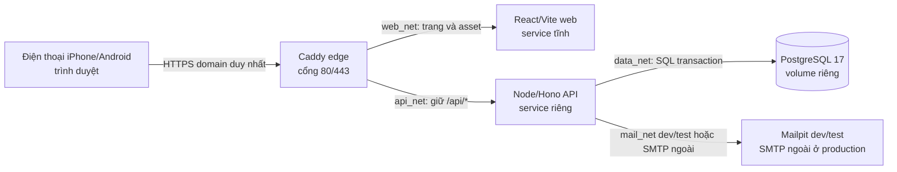

# Kiến trúc hạ tầng đề xuất cho CapMoney

**Lịch sử, cần vẽ lại:** sơ đồ này thuộc TS09/ADR 0002 Node/Hono. Ninh đã chọn [TS10–TS38](../../docs/requirements/tech-stack-round-2.md): Java Spring, Redis, Tailwind, production cài trực tiếp trên VPS. Không dùng sơ đồ Docker production/Node API bên dưới làm hợp đồng mới. Docker dev/test Node đã chạy một phần nhưng QA IF-T03 fail; stack đã dừng. Cần ADR/sơ đồ mới qua Tech/PM review trước code Java.

## Sơ đồ luồng chạy

Chỉ Caddy có cổng public. Bốn mạng tách biệt: `web_net` chỉ Caddy/web, `api_net` chỉ Caddy/API, `data_net` chỉ API/PostgreSQL, `mail_net` chỉ API/Mailpit ở dev/test. API/DB/Mailpit không publish ra Internet; production không chạy Mailpit. Dev bind Caddy vào `127.0.0.1` để người ngoài máy không truy cập. Một repo chứa hai ứng dụng; không có app mobile native hoặc offline. React chỉ gọi `/api/*` cùng origin. Hợp đồng API/kiểu dữ liệu chia sẻ ở gói `packages/contracts` nếu có giá trị thực, không chia sẻ logic quyền/DB cho browser.

## Môi trường và dữ liệu

| Môi trường | Chạy ở đâu | Dịch vụ | Dữ liệu/secret | Điều kiện xong |
| --- | --- | --- | --- | --- |
| Dev | Máy phát triển, Docker Compose | Caddy HTTP local, Vite web, Hono API, PostgreSQL, Mailpit | DB và email thử riêng; secret file ngoài Git | `compose config`, healthcheck, route web/API, Mailpit nhận thư, DB sống qua restart container |
| Test tích hợp | Docker Compose cô lập hoặc CI | Cùng sơ đồ dev, DB test có reset/seed riêng | Không đọc DB dev/production; đồng hồ/thời gian thử điều khiển được | test API, transaction đồng thời, quyền/phiên, email lỗi, UI browser trên build/commit xác định |
| Production tương lai | Một VPS riêng của Ninh | Caddy HTTPS, web image tĩnh, API image Node, PostgreSQL volume; SMTP bên ngoài | Secret chỉ trên VPS qua Compose secrets/file quyền hạn chế; không có Mailpit | Sau ticket/gate/QA, domain+DNS, HTTPS, SMTP thật và quyền vận hành được cung cấp; Ninh duyệt bước mở thật |

Không triển khai staging mặc định vì Ninh chưa chọn môi trường này. Khi cần, dựng Compose riêng với DB/secret riêng, không chia sẻ với production. Không tự tạo VPS, domain hoặc tài khoản dịch vụ trong bước kiến trúc.

## Biên an toàn và trạng thái

- **Browser → Caddy:** TLS production, một origin, CSP giới hạn nguồn. Cookie phiên `HttpOnly`, `Secure` production, `SameSite=Lax`, `Path=/`, host-only; không lưu token phiên trong localStorage. Dev HTTP dùng cookie tên khác và không bật trong production.
- **Caddy → API:** Caddy giữ nguyên `/api/*`, Hono khai báo cùng prefix; đường khác tới web service và web server trả `index.html` cho deep link như `/manager/setup`, trừ asset tồn tại. Caddy không strip `/api`. API so sánh `Origin` của POST/PUT/PATCH/DELETE với `APP_ORIGIN` là origin HTTPS ngoài, từ chối thiếu/sai, kiểm phiên/quyền tại từng handler. Cookie `Path=/`. Caddy nhận client trực tiếp, ghi đè `X-Real-IP` và `X-Forwarded-For` bằng địa chỉ TCP peer mà Caddy thấy, bỏ qua giá trị client đưa vào. API kiểm socket peer **đúng IP Caddy cấu hình riêng trên `api_net`**, và header IP phải chứa đúng một địa chỉ hợp lệ; nếu không thì fail-closed trước auth/throttle. API không có host port, trình duyệt không gọi trực tiếp. Khi đổi proxy/VPS topology phải review lại nguồn IP trước khi dùng throttle. Lệnh bootstrap CM-01 chỉ chạy CLI nội bộ bằng quyền người triển khai, không có endpoint HTTP.
- **API → PostgreSQL:** một DB nguồn sự thật. `pg` dùng transaction trên cùng client; biến động số dư/tiêu thụ link cần khóa và ràng buộc nguyên tử. Tiền VND lưu số nguyên nhỏ nhất tương ứng đồng VND, không dùng float. Truy vấn tài chính luôn giới hạn theo chủ tài khoản; quyền phải được thử với ít nhất hai tài khoản. RLS ở PostgreSQL là đề xuất phòng vệ thêm khi thiết kế bảng tài chính, chưa phải thay thế kiểm quyền API.
- **API → SMTP:** Nodemailer dùng SMTP ngoài hệ thống; ở dev/test chỉ Mailpit. Trạng thái gửi chưa rõ phải fail-closed theo thiết kế CM-01, không tạo nhiều link cùng hiệu lực. Không log token, mật khẩu, nội dung email nhạy cảm.
- **Lưu bền:** PostgreSQL volume tồn tại qua restart/recreate container. Không coi volume là backup; S04/R52 chấp nhận chưa có khôi phục sau hỏng VPS/volume. Trước vận hành thật, PM nhắc lại rủi ro và ghi quyết định phát hành.

## Cấu trúc code và triển khai dự kiến

- Monorepo `apps/web` (Vite/React/TypeScript), `apps/api` (Hono/Node 24 LTS/TypeScript), `packages/contracts` khi cần, `infra/` cho Compose/Caddy và tài liệu vận hành. Tách build, lệnh kiểm tra và image web/API. Không dùng code iOS/API cũ.
- Compose dev dùng volume dữ liệu test, healthcheck PostgreSQL và API; startup không dựa duy nhất vào thứ tự container, API xử lý DB chưa sẵn sàng bằng lỗi vận hành. Compose production dùng image gắn SHA commit, không bind mount mã nguồn, restart policy và Compose secret file riêng từng môi trường; `docker compose config` phải không in **giá trị** secret. Caddy tự lấy/gia hạn chứng chỉ khi có domain/DNS phù hợp. Secret/DB dev, test và production không dùng chung.
- GitHub Actions dự kiến chạy typecheck, lint, Vitest, test tích hợp PostgreSQL/Mailpit và Playwright mobile viewport; tạo image chỉ từ commit đã qua kiểm. Triển khai VPS sau này là thao tác riêng cần bản chạy và QA, không tự phát hành từ mọi push.

## Thứ tự thực hiện và gate

1. Tech lập tài liệu này và ADR 0002; reviewer Tech khác người lập rà, PM đối chiếu TS01–TS09, Ninh xác nhận tiếp tục. **Hoàn thành ở mức thiết kế.**
2. PM tạo ticket hạ tầng có AC quan sát được, phụ thuộc và người review; Tech/PM xét readiness theo workflow. Dev dựng Docker Compose dev/test, Caddy route, DB volume, Mailpit/health; reviewer khác người code kiểm và QA thử thực tế. Không cần FE/BE thật để kiểm route/health tối thiểu; các endpoint thử không thành đường sản phẩm công khai. **#47 đã qua readiness và Dev self-check; đang chờ review/QA độc lập.**
3. Tech cập nhật CM-01 technical-design và ADR 0001 theo web/API tách; reviewer Tech độc lập và PM cấp lại `TECH_READY`/`READY_FOR_IMPLEMENTATION` #43. Sau đó FE/BE theo chuỗi #43→#44→#45, PM và QA từng lát.
4. Khi các Story bản đầu đã qua QA, chuẩn bị VPS/domain/SMTP thật; PM/QA kiểm tích hợp, hai điện thoại, ít nhất hai tài khoản theo S02/S05/S10/S11/S13 trước khi Ninh quyết định mở cho khoảng 10 người. Không đánh dấu QA pass từ sơ đồ hoặc test đơn vị.

## Điểm cần chứng minh trước khi nhận hạ tầng đã sẵn sàng

- Route web `/`, deep link `/manager/setup` và API `/api/health` qua cùng origin; kiểm Caddy giữ `/api` để Hono khớp route. API/DB không truy cập trực tiếp từ ngoài; thử `Origin` thiếu/sai, header IP giả từ client, socket peer không phải Caddy và nguồn IP có nhiều/giá trị sai.
- PostgreSQL volume giữ dữ liệu qua restart container; test DB cô lập, không kết nối nhầm production; secret không vào image/Git/log.
- Mailpit nhận email thử từ CLI/test runner dùng cấu hình API; SMTP lỗi/timeout cho trạng thái quan sát được; không tạo HTTP endpoint gửi thư thử và production không chạy Mailpit.
- Hai API instance test dùng chung DB cho session/throttle và transaction trước khi CM-01 QA; sơ đồ một VPS không làm mất yêu cầu đồng thời.
- `docker compose config` và build image thực chạy; `docker compose config` không in giá trị secret. Kiểm từ một máy ngoài VPS chỉ 80/443 public; cấu hình TLS/domain production được kiểm khi có domain, không tuyên bố kiểm từ máy local. Trước mở thật, nhắc lại VPS là điểm lỗi đơn và volume không phải backup theo S04/R52.
