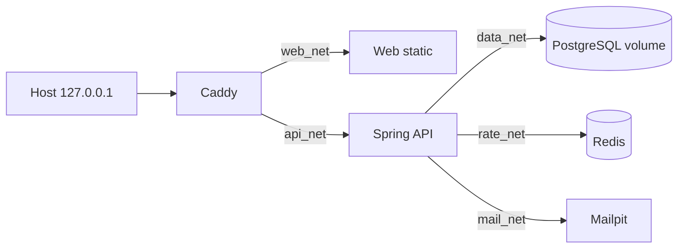

# Technical Design đề xuất: INFRA-01 / Planio #47 — Docker dev/test Java

> **Ưu tiên bảo toàn tài nguyên — Ninh 14/10/2026:** Không chạy reset/down/force-recreate hay xóa container/volume/file. Các nhắc reset/recreate dưới đây là phương pháp kiểm cũ, không còn được phép thực thi. Thay bằng restart và container kế tiếp dùng cùng volume khi container trước đã dừng (giữ cả hai), cùng một môi trường/volume mới để kiểm dữ liệu sạch và dữ liệu cũ không đổi. Caddy dùng container bổ sung cùng secret/subnet để kiểm IP peer thay đổi. `up --no-recreate`, `stop`, `probe-stop` giữ tài nguyên; probe dùng project/cổng/subnet riêng. Đây là điều chỉnh phương pháp theo quyền Ninh đã xác nhận, không thêm chức năng sản phẩm.

**Trạng thái:** `TECH_READY` cho INFRA-01 Java/Redis và `READY_FOR_IMPLEMENTATION` cho ticket #47 ngày 14/10/2026 sau [Tech review độc lập](java-tech-review.md), [BA/Tech ticket review và PM gate](handoff.md); chưa build/chạy Java hoặc QA. [Thiết kế Node/Hono](technical-design.md) và kết quả IF-T01–08 cũ chỉ là lịch sử. **Phạm vi:** [spec 20 mục](spec.md), `AC-IF01-1`–`AC-IF01-5`, [ADR 0003](../../docs/adr/0003-java-spring-and-deployment.md), [TS10–TS38](../../docs/requirements/tech-stack-round-2.md). Không triển khai CM-01 hoặc production VPS trong #47.

## 1. Quyết định đã xác nhận và đề xuất Tech

| Đã được Ninh xác nhận | Cách hiện thực Tech đề xuất cho #47, cần review/test |
| --- | --- |
| Java 25/Temurin, Spring Boot 4.1, Maven, MVC, JPA, Liquibase, Redis/Lettuce, Mail, PostgreSQL | Một Spring JAR duy nhất, profile `dev`/`test`, API chỉ có health/readiness và không có schema nghiệp vụ; kiểm bản vá tương thích bằng Maven build thực. |
| React/Vite/Router/Tailwind, Caddy, Docker chỉ dev/test | Web placeholder build tĩnh; Caddy cùng origin trên loopback và giữ nguyên `/api`; Compose có project/volume/secret tách dev với test. |
| JWT cookie, Spring Security, Redis throttle, Spring Mail/Mailpit | #47 chỉ thiết lập kết nối và ranh giới hỗ trợ; không tạo login, JWT, CSRF sản phẩm, gửi lời mời, hay tài khoản quản lý. Probe POST test-only kiểm trust/Origin trước CM-01. |
| Production Ubuntu/Temurin/systemd/PostgreSQL cài trực tiếp; không sao lưu bản đầu | Không dùng Compose #47 như runbook production. Volume dev/test chỉ giữ dữ liệu qua recreate, không phải backup. |

**Chưa chốt trong #47:** bản vá dependency/image cụ thể, VPS/domain/SMTP thật, Redis đặt trên máy nào ở production. Dev pin bản vá/digest trong manifest và ghi bằng chứng; thay topology production là review riêng. Không có câu hỏi sản phẩm đang chặn thiết kế môi trường dev/test.

## 2. Ranh giới dịch vụ và build

- `apps/api` thay runtime Node/Hono bằng Maven Spring Boot 4.1 trên Temurin 25. Dùng Maven Wrapper được pin và kiểm checksum; build multi-stage với JDK 25, runtime JRE 25 chạy non-root. Pin image digest/version, không dùng `latest`. Chạy JUnit 5/Spring Boot Test/Testcontainers trong test stage/CI; image runtime chỉ chứa JAR sản phẩm, không chứa test classes, probe controller hay SMTP check runner. Không chuyển logic từ source Node cũ sang Java như bằng chứng đã review.
- `apps/web` là Vite/React placeholder ghi rõ “môi trường thử”; `/manager/setup` chỉ là SPA fallback, không giả vờ đã thiết lập quản lý. Web không kết nối PostgreSQL, Redis, Mailpit và không chứa secret. Caddy serve static build hoặc chuyển tới static container; chọn một cách trong Compose và chứng minh deep link reload. Tailwind/Router được pin ở #47. **TS22 TanStack Query + fetch vẫn là lựa chọn đã chốt**, nhưng placeholder không tải dữ liệu sản phẩm nên pin/cài Query tại ticket FE đầu tiên thực sự gọi API; không đưa dependency chưa dùng vào #47. Không làm UI CM-01 ở #47.
- Spring cấu hình `/api` làm base path nhất quán cho MVC. `GET /api/health` trả JSON trạng thái API+PostgreSQL, ví dụ `{ "status": "UP" }` hoặc HTTP 503 với mã `db_unavailable`; không trả DB URL/credential/stack trace. `GET /api/ready/auth` trả trạng thái PostgreSQL **và** Redis, HTTP 503 khi một bên lỗi; tên endpoint này là **đề xuất Tech** để phân biệt health chung với readiness luồng xác thực. Health công khai chỉ trả trạng thái tối thiểu, `Cache-Control: no-store`; chi tiết actuator nội bộ không public. Mailpit/SMTP không suy từ hai endpoint này, được test riêng. Springdoc/OpenAPI 3 phải được pin và smoke-test với Boot 4.1; docs public ở production là quyết định CM-01/vận hành sau, không mặc nhiên mở từ #47.
- Không tạo bảng tài khoản, JWT, ví hoặc tiền trong #47. Liquibase có root changelog hợp lệ (có thể chưa có changeset nghiệp vụ), `ddl-auto=validate` hoặc `none`, không dùng auto-update; Spring Data JPA/JDBC cấu hình đủ để health ping PostgreSQL. Marker persistence của AC-IF01-4 là **dữ liệu thử riêng**, tạo/đọc bằng lệnh SQL test được ghi trong bằng chứng, không thành schema sản phẩm.

## 3. Compose dev/test, mạng và secret

- Chỉ Caddy publish `127.0.0.1:<dev/test port>` ra host. API, PostgreSQL, Redis và Mailpit không khai báo `ports`; web static cũng không publish. `data_net`, `rate_net`, `mail_net` là Compose `internal`; `api_net` dành Caddy↔API và phải có subnet xác định cho kiểm TCP peer. Không dùng IP container động làm `trusted Caddy IP`. Caddy không nối `data_net`/`rate_net`/`mail_net`; web không nối tới chúng. Nếu có tool container để đọc Mailpit UI/API, chỉ chạy profile `test/tools` và không publish host port. Lệnh inspect sau build phải chứng minh topology thực, không suy từ YAML.
- Dev/test có Compose project name, `pg_data`, Redis namespace/DB, tên DB và file secret riêng; `test reset` chỉ xóa volume **test** sau khi kiểm project name. `down` thường giữ volume. Không mount volume Node cũ hoặc DB production vào stack mới. PostgreSQL 17 và Mailpit phiên bản cũ chỉ là lịch sử; pin phiên bản/digest hiện thực theo kiểm tương thích và ghi rõ trong `infra/README.md`.
- `APP_ORIGIN` bắt buộc chính xác origin Caddy loopback của môi trường đó; thiếu, origin khác, hoặc production URL trong dev/test phải từ chối ở script/startup. PostgreSQL password và edge secret đủ ngẫu nhiên lưu file ngoài Git (`0600`, thư mục `0700`) rồi mount read-only qua Compose secrets. Edge secret **đề xuất** là đúng 64 ký tự hex ASCII sinh ngẫu nhiên, file không có byte xuống dòng hoặc khoảng trắng; cả Caddy và API đọc đúng cùng chuỗi byte, từ chối file sai định dạng/độ dài, không tự `trim` tùy ý. Caddy dùng runtime file placeholder đã kiểm bằng `caddy adapt`; phép thử request thật xác nhận header hợp lệ được chấp nhận và header đổi một byte bị từ chối, vì `caddy adapt` chỉ kiểm cú pháp. Không đặt giá trị bí mật trong `.env`, command line, build arg, image layer hay environment được `docker compose config` in ra. File example chỉ có tên biến/giá trị giả; secret paths có thể hiển thị nhưng giá trị không. Log health/probe không ghi secret/header token. Tách secret dev/test, không tái sử dụng key production.
- `depends_on` health condition giúp thứ tự khởi đầu nhưng **không** là cơ chế phục hồi sau outage. API có restart policy phù hợp cho **khởi động ban đầu khi DB chưa có hoặc JVM crash không dự kiến**. Sau khi JVM đã khởi động và phục vụ request, mất PostgreSQL/Redis tạm thời **không được làm JVM thoát hoặc restart**: request `/api/health` và `/api/ready/auth` vẫn do cùng tiến trình trả HTTP 503 khi phụ thuộc liên quan hỏng, không chuyển thành Caddy 502. Kiểm timeout hữu hạn ở datasource, Redis và health check; tránh giữ kết nối chết vĩnh viễn. PID giữ nguyên, uptime không reset qua outage và readiness tự `UP` lại khi phụ thuộc trở về, không rebuild hoặc restart tay. SMTP timeout hữu hạn và lỗi không được báo đã gửi.

## 4. Hợp đồng Caddy → Spring và Origin probe

ADR 0003 là nguồn hợp đồng; #47 phải hiện thực và kiểm các điểm sau trước khi CM-01 dùng IP cho throttle:

1. Caddy là ingress duy nhất. Caddy **ghi đè** `X-Forwarded-For` và `X-Real-IP` bằng một địa chỉ `{remote_host}` từ TCP peer của chính Caddy; loại `Forwarded` và `X-Forwarded-Host` do client gửi; đặt `X-Forwarded-Proto` theo scheme Caddy. Caddy ghi đè `X-CM-Edge-Auth` bằng secret từ file. `caddy adapt` phải qua và request gửi header giả qua Caddy phải đến API với giá trị chuẩn hóa. Dev HTTP loopback được cấu hình riêng; không giả đã kiểm cookie Secure/TLS production.
2. Spring để `server.forward-headers-strategy=none` và không bật filter/valve viết lại remote address trước ingress filter. Filter chạy trước auth và throttle, lấy TCP peer thật bằng `HttpServletRequest.getRemoteAddr()`. Chỉ chấp nhận peer thuộc subnet `api_net` đã cấu hình **và** edge secret so hằng thời gian. Trong production sau này điều kiện peer là loopback **và** secret; không dùng subnet dev làm chính sách production. Kiểm `X-Forwarded-For` và `X-Real-IP` đều có đúng một IP hợp lệ (IPv4/IPv6), không comma/giá trị lặp, và bằng nhau; sai/thiếu thì từ chối trước auth/throttle, không fallback sang giá trị từ client. Không dựa vào `Host`/`X-Forwarded-Host` để suy IP. `GET /api/health` chỉ cho trạng thái tối thiểu; mọi request nhạy cảm phải qua filter.
3. Probe `POST /api/__probe` chỉ được khai báo trong Java **test source set** hoặc image test riêng, không nằm trong main/runtime JAR. Image test phải nạp **cùng main JAR, cùng ingress filter và Origin policy** với runtime; chỉ thêm test route/test classes, không thay filter hoặc tạo bypass. `Origin` phải bằng `APP_ORIGIN`, thiếu/sai bị 403 **trước khi** probe đổi marker test. Origin đúng nhưng peer/header/secret sai cũng bị từ chối. Không dùng probe để chứng minh CSRF hoặc JWT của CM-01. Test tự kiểm runtime image trả 404 tại `/api/__probe`; test image/probe chỉ chạy trong project test. Nếu test source set không bảo đảm loại route khỏi JAR, dừng gate và đổi cách đóng gói rồi review lại.
4. Direct API probe được gửi từ container cố ý nối `api_net`, không từ host port công khai; thử thiếu/sai secret, peer khác Caddy, XFF/X-Real-IP thiếu/nhiều/không khớp/malformed. Vì subnet một mình không định danh Caddy, secret là điều kiện bắt buộc. Recreate Caddy phải hoạt động với secret/subnet ổn định dù IP container đổi. Ghi kết quả HTTP và kiểm marker không đổi khi request bị từ chối. Phạm vi secret/peer test là môi trường thử, không đưa đường bypass vào production.

## 5. Email thử, lỗi phụ trợ và dữ liệu

- Java Mail test runner ở test source set hoặc JUnit integration test dùng `JavaMailSender` và SMTP `mailpit:1025` qua `mail_net`; gửi tới `manager@example.test`, đọc Mailpit API nội bộ để chứng minh một thư nhận. Không tạo HTTP endpoint gửi thư; không cần tài khoản quản lý. Thử SMTP refused và timeout với host/port giả hoặc proxy fault test; phản hồi phân biệt “không xác định đã gửi” khi timeout với “bị từ chối”, không báo thành công. SMTP thật, giao mail tới người thật và generation/CAS của CM-01 thuộc ticket sau.
- PostgreSQL marker ghi trong DB test, kiểm sau `restart` và `up --force-recreate`; đọc lại bằng test tool. Chỉ lệnh reset test được xóa volume test. Kiểm project/volume dev trước và sau reset để chứng minh không bị tác động. Không gắn production URL, secret hoặc volume vào test.
- Redis trong #47 chỉ chứng minh ping/readiness và mất/phục hồi. Bộ đếm throttle/ngưỡng, fail closed của setup/login và nhiều user cùng NAT thuộc thiết kế CM-01, không tự đạt từ Redis ping. Khi Redis mất, `/api/health` có thể còn `UP` nếu PostgreSQL khỏe; `/api/ready/auth` phải `DOWN`/503. Khi PostgreSQL mất **sau khi API đã lên**, cả hai phải trả HTTP 503 từ **cùng JVM/PID**, không Caddy 502 và không restart. Khi PG hoặc Redis quay lại, endpoint liên quan tự trở `UP` trong cùng tiến trình; restart policy không được dùng để qua phép thử này. Không ghi dữ liệu tài chính trong bộ nhớ lúc DB lỗi.

## 6. Kiểm chứng bắt buộc để PM xét ticket #47

Mỗi case lưu **commit, image digest, Compose project, lệnh, exit code, HTTP status/body hoặc log đã che secret**. Đây là kế hoạch; không case nào được ghi `pass` trước khi chạy trên Java.

| Mã | AC | Bằng chứng Dev/QA cần thực chạy |
| --- | --- | --- |
| V1 | 1 | Pin bản vá Boot/springdoc, Maven Wrapper và JDK; Maven build/JUnit + Testcontainers PostgreSQL/Redis trên host hoặc CI runner **có Docker daemon**, không giả Docker daemon ở trong runtime image; smoke `/v3/api-docs` nếu được bật trong test. Runtime image không có test class. Compose config/image/Git không lộ secret, sai/thiếu config fail rõ. |
| V2 | 1–2 | Compose dev/test dựng Caddy, web, Java, PG, Redis, Mailpit; GET `/`, reload `/manager/setup`, `/api/health`, `/api/ready/auth` cùng origin; `/api` giữ prefix; runtime probe 404. |
| V3 | 2 | Ghi PID/uptime của JVM đang healthy; dừng PG: `/api/health` và `/api/ready/auth` liên tục trả **HTTP 503, không 502**, PID/uptime không reset; bật PG, cả hai tự `UP` với cùng PID, **không rebuild/restart tay**. Lặp lại với Redis: `/api/health` vẫn phản ánh PG, auth readiness 503 rồi hồi phục với cùng PID. Kiểm riêng khởi động ban đầu khi PG chưa có: restart policy đưa API lên sau khi PG có; trường hợp này không thay hợp đồng outage của JVM đang chạy. |
| V4 | 3 | Inspect publish ports/networks: chỉ Caddy ở loopback, web không chạm DB/Redis/Mailpit; host không kết nối trực tiếp API/PG/Redis/Mailpit. |
| V5 | 3 | Probe POST test-only: Origin thiếu/sai; forged/duplicated/malformed XFF/X-Real-IP; peer/secret thiếu/sai; request qua Caddy chuẩn; Caddy recreate; kiểm HTTP và marker trước/sau **mọi request bị từ chối**. Kiểm file edge secret đúng 64 byte hex không newline, Caddy/API dùng cùng bytes bằng request thật và secret đổi một byte bị từ chối; không in giá trị qua log/`compose config`. `caddy adapt` qua; test image dùng cùng main JAR/filter, runtime image không có probe. |
| V6 | 4 | Marker PG còn qua restart/recreate; reset test chỉ xóa volume test, dev marker không đổi; volume không được ghi là backup. |
| V7 | 5 | JavaMailSender gửi Mailpit, đọc hộp qua nội bộ; SMTP refused/timeout báo lỗi/unknown tương ứng, không tạo endpoint public hay phát tán secret. |
| V8 | 1–5 | Từ trạng thái stopped dựng lại stack trên image/build đã pin, chạy lại route/health/network/marker/mail; lập QA evidence theo IF-T01–08 mới, không kế thừa `pass` Node/Hono. |

## 7. Gate, phụ thuộc và rủi ro còn mở

- Reviewer Tech khác người soạn đã kiểm lại P1 outage và các P2 trong [review INFRA Java](java-tech-review.md); PM đã đối chiếu đúng năm AC và TS10–TS38, ghi `TECH_READY` ở [handoff](handoff.md). BA/Tech đã rà ticket #47 Java, PM cấp `READY_FOR_IMPLEMENTATION` sau khi tách TS22 sang FE ticket dùng API. Bản vá dependency, `getRemoteAddr` thực, Caddy file placeholder/edge secret byte-for-byte, test-only probe, outage recovery và Compose secret vẫn phải có bằng chứng Dev/QA trên build Java, chưa được coi đã chạy.
- #47 là `HARD` blocker của CM-01 #43 cho tích hợp; hoàn thành stack không tự cấp gate CM-01. CSRF, JWT cookie/DB revocation, refresh reuse, quota Redis, hai API instance, email invitation/CAS, màn thiết lập và mobile QA thuộc CM-01. GitHub Actions đầy đủ và VPS direct install/systemd/TLS/runbook rollback là công việc sau có gate riêng.
- Rủi ro chặn gate nếu chưa giải: dependency Boot/springdoc không build cùng nhau; Caddy/servlet không chứng minh peer thực; probe lọt runtime; Compose secrets hiện giá trị qua config/log; DB outage làm JVM/health kẹt như IF-T03 cũ. Nếu xảy ra, ghi lỗi và trả Tech/Dev để sửa, không chuyển `TECH_READY`/`QA_PASS` bằng mô tả này.
