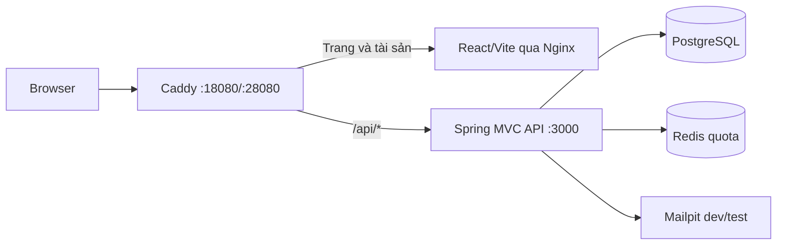

# CapMoney: kiến trúc và phạm vi đang chạy

**Snapshot:** 16/10/2026, mã nền đến commit `4a4a1a4` trên `feat/cm-01-manager-setup`. Tài liệu này mô tả code đã có; [TS10–TS38](requirements/tech-stack-round-2.md) và [ADR 0003](adr/0003-java-spring-and-deployment.md) ghi lựa chọn/thiết kế, còn [handoff CM-01](../.scratch/capmoney-manager-setup/handoff.md) ghi bằng chứng và gate. Production VPS chưa được triển khai.

## Phạm vi

Bản đầu được định hướng cho web mobile first, tài khoản riêng, ví và thu/chi VND. **Hiện chỉ có luồng CM-01**: người triển khai phát hành link thiết lập đầu tiên, Ninh đặt mật khẩu, đăng nhập và vào khu vực quản lý tối thiểu. `/` là placeholder; chưa có ví, danh mục, giao dịch, mời người ghi chép, tự đăng ký, đặt lại mật khẩu hoặc triển khai thật. Ranh giới tính năng xem [spec tổng thể](../.scratch/capmoney-overall/spec.md) và [spec CM-01](../.scratch/capmoney-manager-setup/spec.md).

## Đường đi request và dữ liệu

- Một origin qua Caddy phục vụ web và API; chỉ Caddy bind loopback trên host. API, PostgreSQL, Redis, Mailpit ở mạng nội bộ Compose. Browser không truy cập DB/Redis/SMTP. `infra/Caddyfile` chỉ proxy `/api/*`; không coi `/v3/api-docs` là route public qua Caddy dù Spring có khai báo nội bộ.
- API Java 25/Spring Boot 4.1/Spring MVC dùng JPA và Liquibase. Code theo tính năng/lớp MVC trong `apps/api/src/main/java/com/capmoney/api/`; migration có version trong `apps/api/src/main/resources/db/changelog/`. PostgreSQL giữ manager, link thiết lập và family phiên; Redis giữ quota, không giữ dữ liệu tài chính.
- `apps/web` là React/Vite/React Router/Tailwind; TanStack Query + `fetch` gọi API cùng origin. Quyền quyết định ở API. FE không giữ JWT trong storage; access/refresh ở cookie HttpOnly.
- Secret PostgreSQL, edge, JWT signing và refresh lookup được sinh trong `.local/secrets/<dev|test>/` (mode 600, không vào Git). Entry point container sao chép chúng vào tmpfs với chủ sở hữu phù hợp trước khi API chạy dưới UID 10001. Các request nghiệp vụ Caddy→API cần peer/header/edge secret hợp lệ; hai GET health/readiness công khai là ngoại lệ. POST setup/auth cần Origin và CSRF hợp lệ.

## Luồng CM-01 hiện có

| Bước | Web / API | Hành vi chính |
| --- | --- | --- |
| Sức khỏe | `GET /api/health`, `GET /api/ready/auth` | Health kiểm DB; readiness auth kiểm DB và Redis. Hai GET có thể gọi qua Caddy mà không cần phiên. |
| Phát hành link | CLI `--capmoney.bootstrap-manager` | Lệnh nội bộ gửi email qua SMTP/Mailpit và ghi generation, không có endpoint đăng ký/gửi link công khai. Xem [runbook](../.scratch/capmoney-manager-setup/bootstrap-runbook.md). |
| Thiết lập | `/manager/setup`, `GET /api/auth/csrf`, `POST /api/manager/setup` | Link token trong URL fragment, dùng một lần, 72 giờ; hoàn tất tạo đúng một manager và chuyển sang login, chưa cấp phiên. |
| Đăng nhập | `/manager/login`, `POST /api/auth/login` | Email/mật khẩu; Redis quota 10 lần/IP và 60 lần/account cố định trong 15 phút, kể cả thành công; cấp cookie access 15 phút và refresh family tối đa 7 ngày. |
| Phiên | `/manager`, `GET /api/manager/me`, `POST /api/auth/refresh` | API xác minh JWT và trạng thái family/epoch trong DB; refresh rotate một lần, reuse thu hồi family tương ứng. FE reload/deep link hỏi API lại. |
| Đăng xuất | `POST /api/auth/logout` | Access hợp lệ hoặc refresh hiện hành thu hồi mọi family quản lý; DB lỗi trả trạng thái thu hồi chưa rõ, không báo thành công. |

Các POST nhạy cảm yêu cầu CSRF cookie/header và Origin đúng; JSON setup/login tối đa 4 KiB. Mã lỗi API không mang token/mật khẩu. Hợp đồng chi tiết và ngoại lệ nằm trong [thiết kế Java CM-01](../.scratch/capmoney-manager-setup/technical-design-java.md) và code controller; bảng này chỉ là bản đồ đọc nhanh.

## Môi trường và mức xác nhận

`infra/compose.yaml` là môi trường **dev/test**, không phải phương án production. `infra/scripts/stack.sh` giữ volume/container khi dừng và không recreate mặc định; xem [runbook](../infra/README.md). Production được Ninh chọn theo hướng Ubuntu 24.04, Caddy, Java/systemd, PostgreSQL cài trực tiếp trên VPS; hiện chưa có VPS/domain/TLS/SMTP thật, quy trình triển khai, khôi phục hay bằng chứng vận hành. TS26 chấp nhận chưa có backup ở bản đầu; volume dev/test không phải backup.

Hạ tầng #47/#48 và CM-01.1 #43 đã có QA theo ticket. #44 có kết quả tự chạy nhưng còn cần QA độc lập/PM; Planio #44 đã được [đối chiếu](../.scratch/capmoney-manager-setup/tracker-reconciliation-2026-10-16.md) về `In Progress/0%`. #45 đã có mã và [sửa lỗi refresh](../.scratch/capmoney-manager-setup/qa45-refresh-unknown-fix.md) nhưng chưa `DEV_REVIEWED`/`QA_PASS`, đồng thời còn `HARD` #44 → #45. Story CM-01 chỉ được xét sau test regression T21 và thiết bị thật theo CM01-Q4. [Bằng chứng #44](../.scratch/capmoney-manager-setup/qa44-evidence.md), [bằng chứng Dev #45](../.scratch/capmoney-manager-setup/qa45-dev-evidence.md) và [test spec](../.scratch/capmoney-manager-setup/test-spec.md) là nơi đối chiếu từng case; không lấy số test unit thay cho QA toàn luồng.
