# WORKFLOW BOT CAPMM END_TO_END

# QUY TRÌNH CHUẨN WORKFLOW BOT CAPMM (END-TO-END)

## Tích Hợp Đầy Đủ: CapmmBA → CapmmPM → CapmmTech → CapmmPM → CapmmDev → CapmmPM → CapmmQA

---

### 1. Cơ chế kích hoạt `BA_READY` chuẩn hóa hiện tại

Vì không còn trạng thái vật lý mang tên `[Capmm BA] Ready`, quy trình làm việc được chuẩn hóa theo cơ chế **Trạng thái Tiêu chuẩn kết hợp Thẩm định Ngữ nghĩa (Standard Status + Semantic Gate Verification)**:

- **Trạng thái vật lý trên Dona:** Story đạt điều kiện nghiệp vụ sẽ ở trạng thái **`Open` (ID: 1)**.
- **Cổng xác nhận nghiệp vụ (BA Gate):** CapmmBA bắt buộc để lại comment chính thức theo định dạng 5 trường chuẩn với `RESULT: BA_READY` (hoặc `REQUIREMENT_READY`) và cập nhật Notion Feature Spec sang trạng thái `Ready`.
- **Trigger kích hoạt CapmmPM:** Story trên Dona có trạng thái **`Open` (1)** VÀ có xác nhận `BA_READY` từ CapmmBA (minh chứng thực tế hôm nay 22/09/2026 tại vé #31130: CapmmPM ghi nhận *“Đã xác nhận BA_READY + SKIP_TECH … và chạy break-implementation-tasks”* khi Story đang ở `Open`).

---

## 2. BẢN ĐỒ KIẾN TRÚC VÒNG ĐỜI BOT CAPMM (LIFECYCLE OVERVIEW)

```mermaid
flowchart TD
    %%[INPUT ĐẦU VÀO] BƯỚC 1: HUMAN KHỞI TẠO NGUỒN YÊU CẦU GỐC
    subgraph STEP_1["[INPUT ĐẦU VÀO]BƯỚC 1: HUMAN KHỞI TẠO NGUỒN YÊU CẦU GỐC"]
        Human_Source["Khách hàng / Human PM / Designer"]
        Human_Source --> Human_PRD["Viết PRD, Feature List,<br/>Screen Spec trên Notion Hub"]
        Human_PRD --> Human_Figma["Vẽ UI/UX Wireframe & Figma"]
        Human_Figma --> Human_Roadmap["Thống nhất Roadmap<br/>& Mục tiêu Sprint"]
    end

    %%[INPUT ĐẦU VÀO] BƯỚC 2: CAPMM PM TẠO CANDIDATE STORY TRÊN DONA
    subgraph STEP_2["[INPUT ĐẦU VÀO]BƯỚC 2: CAPMM PM TẠO CANDIDATE STORY TRÊN DONA"]
        Human_Roadmap --> PM_SprintPrep["CapmmPM: sprint-planning<br/>(Làn chuẩn bị Sprint N+1)"]
        PM_SprintPrep --> PM_Scan["Quét Notion Feature Spec Hub<br/>và Scope List"]
        PM_Scan --> PM_Candidate["Bóc tách thành Candidate Story<br/>(Tracker: Story, Parent: Epic)"]
        PM_Candidate --> PM_CreateStory["Tạo Story trên Dona<br/>ở trạng thái New (12)"]
        PM_CreateStory --> PM_StoryInfo["Goal & Phạm vi màn hình<br/>Link tham chiếu Notion<br/>Tóm tắt Business Rules & Dependencies<br/>Chờ CapmmBA build lại spec + review readiness"]
        PM_StoryInfo --> PM_CreateBATask["Tạo Task con: [CapmmBA] Review User Story: US-xx<br/>Gán cho Capmm BA"]
    end

    %% GIAI ĐOẠN 0: REQUIREMENT TRACK (CapmmBA)
    subgraph PHASE_0["GIAI ĐOẠN 0: REQUIREMENT TRACK (CapmmBA)"]
        PM_CreateBATask --> RawInput["Input: PRD, Figma,<br/>Sheet Q&A/BR, Dona Backlog"]
        RawInput --> BA_Build["build-feature-spec<br/>(Chuẩn hóa 20 mục Notion)"]
        BA_Build --> BA_Review["review-user-story<br/>(Kiểm tra AC, BR, Traceability)"]
        BA_Review --> Check_BA{Đủ điều kiện?}
        Check_BA -- "Có Gap / Hỏi khách" --> BA_Gap["log-project-qna / process-customer-qna<br/>Story: [Capmm BA] Rejected (18)"]
        BA_Gap --> Human_PM["Human PM gửi Q&A cho Khách"]
        Human_PM --> BA_Update["update-requirement-spec<br/>(Cập nhật lại Notion)"]
        BA_Update --> BA_Review
        Check_BA -- "Đủ điều kiện" --> BA_Ready["Story đạt [Capmm BA] Ready (17)<br/>(BA_READY)"]
    end

    %% GIAI ĐOẠN 1 & 2: CapmmPM & CapmmTech
    subgraph PHASE_1_2["GIAI ĐOẠN 1 & 2: SPRINT PLANNING & TECH DESIGN"]
        BA_Ready --> PM_Plan["CapmmPM: sprint-planning<br/>(Chọn Story vào Sprint N / N+1)"]
        PM_Plan --> Tech_Design["CapmmTech: build-foundation-design<br/>& technical-design"]
        Tech_Design --> Tech_Review["CapmmTech: technical-review (Gate)"]
        Tech_Review --> Check_Tech{Tech Gate?}
        Check_Tech -- "Gap kỹ thuật" --> Tech_Design
        Check_Tech -- "Thấu qua" --> Tech_Ready["STORY_TECH_READY (TECH_READY)"]
    end

    %% GIAI ĐOẠN 3: TASK PREPARATION (CapmmPM)
    subgraph PHASE_3["GIAI ĐOẠN 3: TASK PREPARATION (CapmmPM)"]
        Tech_Ready --> PM_Break["break-implementation-tasks<br/>(Tách Dev Task ≤ 5 AC)"]
        PM_Break --> PM_Check["review-task-readiness<br/>& risk-classification (LOW/MED/HIGH)<br/>& dependency-planning"]
        PM_Check --> PM_Prep["prepare-implementation<br/>(Tổng hợp thông tin, Gán Assignee, Task Open)"]
    end

    %% GIAI ĐOẠN 4: IMPLEMENTATION (CapmmDev)
    subgraph PHASE_4["GIAI ĐOẠN 4: IMPLEMENTATION (CapmmDev)"]
        PM_Prep --> Dev_Code["CapmmDev: Coding theo Spec/FD<br/>Không tự ra quyết định kiến trúc"]
        Dev_Code --> Dev_Review["(Self-review PR)"]
        Dev_Review --> Dev_Resolved["Dev Task → Resolved"]
        Dev_Resolved --> Check_FE{FE có Figma?}
        Check_FE -- "Có" --> Human_Fidelity["HUMAN Dev: Visual Fidelity Polish<br/>PM Human Deploy Staging → Close"]
        Check_FE -- "Không" --> PM_Deploy
    end

    %% GIAI ĐOẠN 5 & 6: STAGING & QA GATE
    subgraph PHASE_5_6["GIAI ĐOẠN 5 & 6: STAGING & QA GATE"]
        Human_Fidelity --> PM_Deploy["CapmmPM: Deploy Staging<br/>& Unblock TEST task"]
        Dev_Resolved --> PM_Deploy
        PM_Deploy --> QA_Plan["CapmmQA: test-planning (Notion Spec)<br/>qa-figma-responsive-precheck"]
        QA_Plan --> QA_Gate["qa-gate-story (Chạy Test trên Staging)"]
        QA_Gate --> Check_QA{Kết quả QA?}
        Check_QA -- "FAIL / Bug" --> Log_Bug["Tạo sub-ticket Bug FE/BE<br/>Route về CapmmDev fix"]
        Log_Bug --> Dev_Code
        Check_QA -- "PASS" --> QA_Pass["Cập nhật Testcase Baseline<br/>Notify Texxa"]
        QA_Pass --> PM_Close["CapmmPM: Close Story & sprint-review"]
    end

    %% STYLING
    style STEP_1 fill:#f4f6f7,stroke:#566573,stroke-width:3px
    style STEP_2 fill:#eaf2f8,stroke:#2874a6,stroke-width:3px
    style PHASE_0 fill:#e8f4fd,stroke:#2b7bb9,stroke-width:3px
    style PHASE_1_2 fill:#fef3e7,stroke:#e67e22,stroke-width:3px
    style PHASE_3 fill:#f3e8fd,stroke:#8e44ad,stroke-width:3px
    style PHASE_4 fill:#eafaf1,stroke:#27ae60,stroke-width:3px
    style PHASE_5_6 fill:#fdedec,stroke:#c0392b,stroke-width:3px
```



---

## 3. GIAI ĐOẠN 0: CAPMMBA — KỸ THUẬT YÊU CẦU & CỔNG NGHIỆP VỤ (REQUIREMENT GATE)

CapmmBA là bot gác cổng đầu tiên của toàn bộ vòng đời phần mềm, chịu trách nhiệm tiếp nhận yêu cầu thô từ khách hàng/sản phẩm, cấu trúc hóa thành tài liệu chuẩn mực, rà soát tính khả thi và logic nghiệp vụ, đồng thời đại diện nhóm dự án làm rõ toàn bộ các câu hỏi mở trước khi đưa vào thiết kế kỹ thuật.

### 3.1. Kích hoạt (Trigger)

- Story mới được tạo trên Dona ở trạng thái `New` .
- Feature Spec / Scope List mới được bổ sung từ khách hàng hoặc Product Owner.
- Story bị trả về từ các bot hạ nguồn (`CapmmPM`, `CapmmTech`, `CapmmDev`) do phát hiện lỗi `NOT_READY_BUSINESS`, xung đột nghiệp vụ hoặc thiếu tài liệu.

### 3.2. Đầu vào (Inputs)

- **`[HUMAN TẠO]` — Tài liệu nghiệp vụ thô (PRD / Feature List / Screen List):** Do Khách hàng hoặc Human PO/PM viết bằng ngôn ngữ tự nhiên.
- **`[HUMAN TẠO]` — File thiết kế Figma (Frames, Components, Tokens):** Do Human UI/UX Designer thiết kế.
- **`[HUMAN TẠO / KHÁCH CHỐT]` — Q&A Sheet & Business Decisions:** Do Khách hàng phản hồi chính thức, Human PM đối soát.
- **`[CAPMM TẠO]` — Khung Story trên Dona (status `New`):** Do CapmmPM tự động quét Scope/Notion để tạo sẵn trên Dona cho CapmmBA bắt đầu thẩm định.
- **`[CAPMM TẠO]` — Requirement Gaps:** Do các bot hạ nguồn (CapmmTech, CapmmDev) phát hiện trong quá trình thiết kế/code và trả ngược về.

### 3.3. Các kỹ năng thực thi (Skills & Operations)

#### Bước 1: Chuẩn hóa đặc tả — `build-feature-spec`

- Chuẩn hóa toàn bộ nội dung nghiệp vụ lên trang **Notion Feature Spec Hub** theo cấu trúc canonical **20 mục**.
- Khung cấu trúc 20 mục bao gồm:
    1. *Executive Summary / User Story statement*
    2. *Actor & Permission Matrix*
    3. *Screen Definition & Entry Points*
    4. *Main Flows (Happy Path)*
    5. *Alternative & Exceptional Flows*
    6. *Field-level Specifications & Validations*
    7. *System Parameters & Constants (`PARAM.*`)*
    8. *Business Rules (`BR-*`)*
    9. *State Machine & Transition Rules (`STATE.*`)*
    10. *Data Fallback & Offline Handling*
    11. *Error Messages & UI Registry (`ERR.*`)*
    12. *Security & Privacy Constraints*
    13. *Third-party Integrations (LINE, Agora, Google…)*
    14. *Audit Log & History Requirements*
    15. *NFR (Performance, Concurrency bounds)*
    16. *Acceptance Criteria (100% đánh số rõ ràng AC1..ACn)*
    17. *Figma Mapping (Node ID & Frame Links)*
    18. *Dependencies (Cross-feature / Cross-story)*
    19. *Q&A Log & Resolved Decisions*
    20. *Change History & Document Traceability*

#### Bước 2: Thẩm định yêu cầu độc lập — `review-user-story`

- CapmmBA thực hiện thẩm định nghiêm ngặt theo nguyên tắc **Evidence Traceability**: *Chỉ các dữ kiện xuất phát từ Figma đã duyệt, Q&A đã xác nhận hoặc Business Rule Sheet có xác nhận của khách mới được coi là căn cứ hợp lệ; cấm tự suy diễn nghiệp vụ không có bằng chứng*.
- Rà soát các tiêu chí cốt lõi:
    - **100% AC Coverage:** Mọi tiêu chí nghiệm thu phải quan sát được, không mơ hồ.
    - **Figma Alignment:** Các thành phần trên UI phải có trong spec và ngược lại.
    - **State Machine Completeness:** Không có trạng thái chết hoặc thiếu chuyển trạng thái.
    - **Scope Boundary:** Phân định rõ In-Scope và Out-of-Scope (tránh trùng lặp với các Story khác).

#### Bước 3: Phát hiện Gap & Quản lý Q&A — `log-project-qna` / `process-customer-qna`

- Khi phát hiện điểm hổng:
    - `GAP-DATA-01`: Thiếu quy tắc xử lý khi dữ liệu null hoặc service ngoài lỗi.
    - `BA_CLARIFICATION_REQUIRED`: Điểm nghiệp vụ chưa thống nhất giữa tài liệu cũ và mới.
    - `CUSTOMER_CONFIRM_REQUIRED`: Quy tắc ảnh hưởng đến tiền, phạt, chính sách người dùng cần khách hàng phê duyệt.
- CapmmBA tạo câu hỏi trên Sheet Q&A và tạo ticket con trên Dona giao cho **Human PM** gửi khách (bằng tiếng Nhật chuẩn business, kèm phương án gợi ý A/B).
- Story trên Dona được chuyển sang trạng thái `[Capmm BA] Rejected` hoặc `Pending` (ID: 18) kèm comment chi tiết lý do chặn.

#### Bước 4: Nhận dạng Yêu cầu Thay đổi (Change Request - CR)

- Trường hợp phát hiện nhu cầu phát sinh ngoài phạm vi hợp đồng (ví dụ tại LunaMoon: cơ chế khấu trừ thuế Thầy bói, cơ chế chống lạm dụng tạo tài khoản farm bonus):
    - Gắn nhãn `CR_CANDIDATE`.
    - Bàn giao sang Human PM / Sale để báo giá và làm CR Form với khách.
    - **Quy tắc bất biến:** Tuyệt đối không tự ý đưa yêu cầu CR vào Story hiện tại khi chưa có chữ ký duyệt của khách hàng.

#### Bước 5: Cập nhật Đặc tả — `update-requirement-spec`

- Khi khách hàng đã trả lời Q&A / chốt Decision:
    - CapmmBA cập nhật lại trang Notion tương ứng.
    - Cập nhật lại các mã AC/BR liên quan.
    - Chạy lại `review-user-story`.

### 3.4. Đầu ra (Outputs)

- **Trang Notion Feature Spec** đạt chuẩn canonical 20 mục (`"2) Fearure spec"`).
- **Kết quả Review:** Đạt `READY` hoặc `READY_WITH_TECHNICAL_DISCRETION`.
- **Trạng thái Story trên Dona:** Chuyển sang `[Capmm BA] Ready` (ID: 17, `BA_READY`).
- Toàn bộ câu hỏi phát sinh đã đóng hoặc có giả định an toàn được PM phê duyệt.

### 3.5. Chuyển giao (Handoff)

- Chuyển giao sang **CapmmPM** để bắt đầu Sprint Planning và đưa Story vào lộ trình thiết kế kỹ thuật.

---

## 4. GIAI ĐOẠN 1: CAPMMPM — LẬP KẾ HOẠCH SPRINT & ĐIỀU PHỐI CHUẨN BỊ

CapmmPM điều phối tổng thể dự án, đảm bảo các Story được đưa vào Sprint cân đối với Capacity, đồng thời quản lý mô hình kế hoạch song song (Sprint N thực thi, Sprint N+1 chuẩn bị).

### 4.1. Kích hoạt (Trigger)

- Story trên Dona đạt trạng thái `[Capmm BA] Ready` (`BA_READY`).
- Chu kỳ Sprint Planning định kỳ của dự án bắt đầu; có Sprint Goal và Milestone rõ ràng.

### 4.2. Đầu vào (Inputs)

- **`[CAPMM TẠO]` — Story đạt chuẩn `BA_READY` trên Dona:** Do CapmmPM tạo ticket, CapmmBA thẩm định đạt chuẩn và để lại comment kích hoạt cổng nghiệp vụ.
- **`[CAPMM TẠO]` — Trang Notion Feature Spec chuẩn 20 mục (`2) Fearure spec`):** Do CapmmBA cấu trúc hóa và duy trì độc quyền.
- **`[HUMAN TẠO]` — Team Capacity (Giờ công khả dụng):** Do Human PM tổng hợp từ lịch trình nghỉ phép, cam kết của các lập trình viên thật và bot quota.
- **`[HUMAN TẠO]` — Sprint Goal & Deadline:** Do Human PM cùng Khách hàng chốt trong buổi Sprint Planning định kỳ.
- **`[HUMAN TẠO]` — Project Policy (`policy_*.yaml`):** Cấu hình phân quyền bot, mẫu comment Dona do Human Tech Lead/PMO thiết lập.

### 4.3. Các kỹ năng thực thi (Skills & Operations)

- **Kỹ năng `sprint-planning`:**
    - **Mô hình 2 làn song song (Dual-Track Planning):**
        - *Làn Sprint N (Implementation Track):* Chỉ chọn các Story đã đủ **cả 2 điều kiện**: `Requirement READY` (từ CapmmBA) **VÀ** `TECH READY` (từ CapmmTech).
        - *Làn Sprint N+1 (Preparation Track):* Đưa các Story mới đạt `BA_READY` vào kế hoạch làm **Technical Design & Foundation Review** trước 1 Sprint.
    - Kiểm tra điều kiện phụ thuộc (Dependency Check) giữa các Story.
    - Giao việc cho CapmmTech lập Technical Design.

### 4.4. Đầu ra (Outputs)

- Danh sách Story được gán `fixed_version_id` (Sprint Version trên Dona).
- Tạo Task con chuẩn bị kỹ thuật: `[Tech Design] Story Technical Design` giao cho **CapmmTech**.

### 4.5. Chuyển giao (Handoff)

- Chuyển tiếp cho **CapmmTech** để lập thiết kế kỹ thuật chi tiết.

---

## 5. GIAI ĐOẠN 2: CAPMMTECH — THIẾT KẾ KỸ THUẬT & CỔNG KIẾN TRÚC

CapmmTech giải quyết triệt để mọi quyết định kỹ thuật trọng yếu, chuẩn hóa kiến trúc dữ liệu và API contract trước khi Dev chạm vào code, đảm bảo CapmmDev không phải tự đưa ra các quyết định kiến trúc mơ hồ trong khi lập trình.

### 5.1. Kích hoạt (Trigger)

- Có task yêu cầu Technical Design từ CapmmPM sau khi Story đạt `BA_READY`.
- Hoặc Dev Task phát sinh có Technical Detail `HIGH` / `MEDIUM` đòi hỏi quyết định kỹ thuật sâu.

### 5.2. Đầu vào (Inputs)

- **`[CAPMM TẠO]` — Notion Feature Spec & ACs/BRs:** Lấy trực tiếp từ kết quả bàn giao của CapmmBA.
- **`[HUMAN TẠO]` — Figma Design Frames & Link Nodes:** Từ Human Designer.
- **`[CAPMM TẠO / HUMAN DUYỆT]` — Foundation Design (`FD-*` trên Notion `Foundation overview`):** Do CapmmTech xây dựng qua kỹ năng `build-foundation-design` và được Human Tech Lead phê duyệt làm kiến trúc lõi dùng chung.
- **`[KẾT HỢP]` — Base Source Code & Database Schema:** Tích lũy liên tục từ các commit trước đó của cả Human Dev và CapmmDev.

### 5.3. Các kỹ năng thực thi (Skills & Operations)

1. **Kiểm tra và xây dựng Foundation Design (`build-foundation-design`):**
    - Rà soát các thành phần dùng chung: Authentication, Error Envelope, Realtime Channel, File Upload, Transaction Boundary.
    - Nếu Story đòi hỏi cơ chế mới chưa có tiền lệ $\rightarrow$ Phải tạo hoặc cập nhật quyết định nền tảng có mã định danh canonical (ví dụ: `FD-AUTH-009`, `FD-REALTIME-003`).
2. **Lập thiết kế kỹ thuật Story (`technical-design`):**
    - Xác định rõ trách nhiệm từng tầng: FE / BE / DATA / Background Job / Third-party.
    - Chốt chi tiết API Contract (Endpoint, Methods, Payload mẫu, Headers, Mã lỗi, Response mẫu theo chuẩn envelope `FD-API-001`).
    - Thiết kế Data Model (Bảng, Cột, Khóa ngoại, Index, Migration strategy).
    - Xác định xử lý đồng thời (Concurrency, Idempotency, Database Locking).
    - Xác định các đơn vị thực thi đề xuất (Proposed Implementation Units).
3. **Cổng kiểm duyệt kỹ thuật độc lập (`technical-review`):**
    - Là một cổng đánh giá khách quan, không tự tin vào self-report của bước thiết kế.
    - Đánh giá: An toàn bảo mật, tính toàn vẹn dữ liệu, rủi ro tải, tính khả thi của contract.
4. **Đặc tả kỹ thuật cấp Task (`task-technical-spec` — áp dụng cho các task phức tạp):**
    - Áp dụng nguyên tắc: *AC Reference Only* (không diễn giải lại spec nghiệp vụ), *Reuse-First* (tận dụng hàm/component có sẵn), *Delta-Only* (chỉ mô tả phần cần viết thêm).

### 5.4. Đầu ra (Outputs)

- Tài liệu Story Technical Design được lưu trữ và liên kết trên Dona/Notion.
- Kết luận kỹ thuật:
    - `TECH_READY` / `STORY_TECH_READY`: Đạt chuẩn kỹ thuật hoàn toàn.
    - `STORY_TECH_GAP`: Còn hổng kỹ thuật $\rightarrow$ Route lại thiết kế.
    - `STORY_SCOPE_REVIEW_REQUIRED`: Thiết kế phát hiện spec vượt quá năng lực nền tảng $\rightarrow$ Route về CapmmBA / CapmmPM.
    - Ở Task level: `TASK_TECH_READY`.

### 5.5. Chuyển giao (Handoff)

- Quay trở lại **CapmmPM** để tiến hành bẻ nhỏ công việc (Task Breakdown).

---

## 6. GIAI ĐOẠN 3: CAPMMPM — PHÂN RÃ DEV TASK & CHUẨN BỊ THỰC THI

CapmmPM biến Story đã sẵn sàng cả về Nghiệp vụ (`BA_READY`) lẫn Kỹ thuật (`TECH_READY`) thành các gói công việc cụ thể, an toàn và có thể thực thi độc lập.

### 6.1. Kích hoạt (Trigger)

- **`[CAPMM TẠO]` — Story đạt đồng thời `BA_READY` và `TECH_READY`:** Kết quả của 2 cổng kiểm duyệt trước đó.
- **`[CAPMM TẠO]` — Story Technical Design:** Do CapmmTech lập (chốt API contracts, DB schema, Proposed Units).
- **`[CAPMM TẠO]` — Task Technical Spec:** Do CapmmTech chi tiết hóa cho các task có độ phức tạp cao (`MEDIUM` / `HIGH`).

### 6.2. Các kỹ năng thực thi (Skills & Operations)

#### Bước 1: Phân rã công việc — `break-implementation-tasks`

- Chia Story thành các Development Task độc lập theo từng layer:
    - `DATA Task`: Migration DB, Seed dữ liệu nền tảng.
    - `BE Task`: API endpoints, Service logic, Jobs, Mailer.
    - `FE Task`: Giao diện màn hình, Component, State management, API wiring.
    - `INT Task`: Tích hợp bên thứ ba (WebRTC, Realtime, Payment).
- **Quy tắc cứng (Hard Cap):**
    - **Mỗi task tối đa $\le 5$ AC.**
    - AC trong task chỉ được để dưới dạng **Reference Only** (dẫn mã `AC1, AC2...`, tuyệt đối không copy diễn giải lại văn xuôi tránh lệch source of truth).
    - Trạng thái khởi tạo: `Pending` hoặc `New`, `assignee = none`.

#### Bước 2: Kiểm tra độ sẵn sàng của task — `review-task-readiness`

- Đối soát: Task có bám sát Technical Design không? Đã đủ contract đầu vào/đầu ra chưa? Có task nào thiếu test data không?

#### Bước 3: Phân loại rủi ro & Xác định Executor — `risk-classification`

- Phân cấp từng task theo 3 mức độ:
    - **LOW:** Đã có mẫu rõ ràng, chỉ ghép API thông thường, UI tĩnh.
    - **MEDIUM:** Nghiệp vụ có phân nhánh, form phức tạp, optimistic update.
    - **HIGH:** Đụng chạm Transaction tài chính, Concurrency, Realtime, Auth, Security.
- **Quyết định Executor:**
    - `CapmmDev`: Nhận các task LOW, MEDIUM và HIGH đã có Task Tech Spec chuẩn mực.
    - `Human Dev`: Thực hiện task Human Verified

#### Bước 4: Lập kế hoạch phụ thuộc — `dependency-planning`

- Gắn nhãn phụ thuộc tường minh trên Dona:
    - `HARD`: Task B không thể bắt đầu nếu Task A chưa Resolved/Merge (ví dụ: BE cần DB Migration).
    - `CONTRACT`: Task FE có thể code giao diện dựa trên mock data theo API contract đã chốt ở Story Tech Design; chỉ bị block khi tích hợp thực tế.
    - `SOFT`: Thứ tự ưu tiên logic, không chặn tiến trình lập trình.

#### Bước 5: Chuẩn bị thực thi — `prepare-implementation`

- Tổng hợp (consolidate) **CURRENT REFERENCES** trong mô tả task: Link Notion Spec, Story Tech Design, Task Tech Spec, Figma Frame ID, Test data yêu cầu.
- Thẩm định qua **Readiness Gate** và **Human Review Gate**.
- Đủ điều kiện $\rightarrow$ Chuyển Task sang status `Open`, gán assignee thực tế (`CapmmDev` hoặc `Human Dev`).

### 6.3. Đầu ra (Outputs)

- Các Dev Task trên Dona đạt trạng thái `Open` (ID: 1).
- Task đạt nhãn `READY_FOR_IMPLEMENTATION`.
- Có task khung `[CapmmQA] Prepare Test Cases` được khởi tạo song song.
- Comment trên Dona tuân thủ nghiêm ngặt định dạng 5 trường (xem Mục 11).

### 6.4. Chuyển giao (Handoff)

- Chuyển giao sang **CapmmDev** (hoặc Human Dev) để tiến hành code.

---

## 7. GIAI ĐOẠN 4: CAPMMDEV — TRIỂN KHAI CODE & TỰ RÀ SOÁT (IMPLEMENTATION GATE)

CapmmDev tiến hành lập trình theo thiết kế đã được duyệt, tuân thủ kỷ luật kiến trúc và quy chuẩn code sạch, không tự đưa ra các quyết định ngoài luồng.

### 7.1. Kích hoạt (Trigger)

- Dev Task trên Dona ở trạng thái `Open`, đã có Assignee là `CapmmDev`.
- Task đã qua `Readiness Gate` và không bị chặn bởi bất kỳ `HARD Dependency` nào.

### 7.2. Đầu vào (Inputs)

- **`[CAPMM TẠO]` — Task Description với cấu trúc chuẩn `CURRENT REFERENCES`:** Do CapmmPM tự động tổng hợp (chỉ dẫn rõ link Notion Spec, Tech Design, Figma ID, test data seed).
- **`[HUMAN TẠO]` — Quy chuẩn lập trình (Coding Standards, ESLint, TypeScript config, Design System):** Do Human Tech Lead thiết lập sẵn trong repository.
- **`[HUMAN TẠO]` — Figma Vector Assets, Icons, Typography Tokens:** Do Human UI Designer xuất link và assets.
- **`[KẾT HỢP]` — Test Data / Seed Data:** Gồm migration/seed files do CapmmDev/DATA Dev viết kết hợp tài khoản staging do Human PM/QA cấu hình.

### 7.3. Các kỹ năng thực thi (Skills & Operations)

1. **Lập trình theo thiết kế:**
    - Thực thi đúng schema, contract và boundaries đã định nghĩa.
    - **Kỷ luật cốt lõi:** *Không tự ý đưa ra significant technical decision*. Nếu phát hiện điểm bất khả thi hoặc mâu thuẫn trong lúc code $\rightarrow$ Lập tức dừng code, chuyển task về `Pending`, báo cáo gap lên ticket.
2. **Tự rà soát mã nguồn (Self-Review PR) — `proj-code-review`:**
    - Tự kiểm tra pull request trước khi submit:
        - Kiểm tra tuân thủ linter, typecheck.
        - Kiểm tra rò rỉ dữ liệu nhạy cảm.
        - Kiểm tra việc xử lý ngoại lệ (try/catch, fallback UI).
        - Kiểm tra unit test tương ứng cho phần logic mới.
3. **Quy trình riêng cho Frontend Task có Figma:**
    - Sau khi FE Task đạt tiêu chí chức năng $\rightarrow$ Chuyển status `Resolved`.
    - Tạo sub-task `HUMAN — Visual Fidelity Polish` giao cho **Human Dev** (Frontend Designer/Stylist) để tinh chỉnh độ sắc nét giao diện (khoảng cách, font, animation, responsive trên thiết bị thật) trước khi đóng task hoàn toàn.

### 7.4. Đầu ra (Outputs)

- Mã nguồn hoàn chỉnh kèm Unit Test trên Git branch.
- Pull Request (PR) đã vượt qua CI/CD và Self-Review.
- Bằng chứng thực thi (Evidence: screenshot, logs, test run).
- Dev Task trên Dona được chuyển sang trạng thái `Resolved` (ID: 3).

### 7.5. Chuyển giao (Handoff)

- Trả quyền điều phối về cho **CapmmPM** để tiến hành triển khai môi trường staging.

---

## 8. GIAI ĐOẠN 5: CAPMMPM (NHÁNH RESOLVED) — DEPLOY STAGING & MỞ KHÓA TEST

Giai đoạn bản lề đảm bảo toàn bộ mã nguồn được tích hợp và triển khai thành công lên môi trường kiểm thử trước khi bàn giao cho QA.

### 8.1. Kích hoạt (Trigger)

- **`[CAPMM TẠO]` (hoặc `[HUMAN TẠO]`) — Dev Task `Resolved` & Pull Requests:** Do CapmmDev (hoặc Human Dev đối với task thẩm mỹ/task HIGH) hoàn thành.
- **`[CAPMM TẠO]` — Kết quả Self-Review PR:** Sinh ra từ kỹ năng của CapmmDev.
- **`[HUMAN TẠO / DUY TRÌ]` — Môi trường Staging:** Do Human DevOps / SysAdmin thiết lập, duy trì server và cấu hình CI/CD webhook.

### 8.2. Các kỹ năng thực thi (Skills & Operations)

- CapmmPM chạy kỹ năng `prepare-implementation` (nhánh xử lý sau Resolved):
    1. Kiểm tra PR đã được review và merge vào nhánh staging chưa.
    2. Kích hoạt hoặc phối hợp với Human PM/DevOps thực hiện **Deploy Staging**.
    3. Kiểm tra Health-check môi trường staging sau deploy.
    4. Mở khóa (Unblock) các task kiểm thử: Chuyển `TEST Task` từ trạng thái `Pending` / `New` sang `Open`, gán assignee cho **CapmmQA**.
    5. Đổi trạng thái Story cha trên Dona sang `Testing` (ID: 7).

### 8.3. Đầu ra (Outputs)

- Môi trường Staging sẵn sàng mang bản build mới nhất.
- TEST Task được unblock, sẵn sàng để QA thực thi.

### 8.4. Chuyển giao (Handoff)

- Chuyển giao cho **CapmmQA** bắt đầu quy trình kiểm thử chất lượng.

---

## **9. GIAI ĐOẠN 6: CAPMMQA — LẬP KẾ HOẠCH & THIẾT KẾ TEST SPECIFICATION (TEST PLANNING)**

> **Nguyên tắc cốt lõi:**
>
>
> **CapmmQA là bot chuyên trách Kế hoạch & Thiết kế Kiểm thử (Test Planning & Test Design), KHÔNG trực tiếp chạy test trên Staging.**
>
> Nhiệm vụ của CapmmQA là phân tích yêu cầu nghiệp vụ để sinh bộ Test Specification chi tiết trên Notion và tạo các khung TEST Task trên Dona. Khâu thực thi chạy test thực tế trên Staging do **Human QA** hoặc bot chuyên trách **CapmmTest** (Gemini qua skill `dexxa-test`) đảm nhận.
>

### **9.1. Kích hoạt (Trigger)**

- Song song khi CapmmPM chạy `break-implementation-tasks` cho Dev, CapmmPM khởi tạo task `[CapmmQA] Prepare Test Cases: US-xx` giao cho **CapmmQA**.
- Hoặc Story đạt `STORY_TECH_READY` và bước vào chuẩn bị Sprint.

### **9.2. Đầu vào (Inputs)**

- Quy trình phân định rõ rệt 2 nhóm đầu vào giữa **Khâu Thiết kế Testcase** và **Khâu Thực thi Test**:
1. **Đầu vào cho CapmmQA (Chuyên trách Thiết kế Testcase - KHÔNG chạy test):**
    - **`[CAPMM TẠO]` — User Story & Notion Feature Spec:** Từ CapmmPM và CapmmBA.
    - **`[CAPMM TẠO]` — Story Technical Design:** Từ CapmmTech.
    - **`[HUMAN TẠO]` — Figma UI Screens:** Từ Human Designer.
2. **Đầu vào cho Human QA / CapmmTest (Chuyên trách Chạy Test trên Staging):**
    - **`[CAPMM TẠO]` — Test Specification chi tiết trên Notion:** Do CapmmQA lập với độ bao phủ 8 chiều (AC, BR, Boundary, State, Error, Security...).
    - **`[CAPMM TẠO]` — Bộ khung TEST Task trên Dona (`TEST-01`, `TEST-02`...):** Do CapmmQA khởi tạo sẵn với đầy đủ điều kiện tiên quyết và các bước kỳ vọng.
    - **`[HUMAN TẠO]` — Test Credentials & External Accounts:** Do Human QA / Human PM chuẩn bị (Tài khoản Google thật, LINE sandbox, thẻ tín dụng test, tài khoản Admin cấp cao).
    - **`[KẾT HỢP]` — Bản build Staging Live:** CapmmPM kích hoạt deploy mã nguồn, DevOps và Human QA xác nhận môi trường sẵn sàng nhận kiểm thử.

### **9.3. Các kỹ năng & Nhiệm vụ thực thi của CapmmQA (Skills & Operations)**

#### **Bước 1: Lập Test Specification trên Notion — `test-planning`**

- Phân rã kịch bản kiểm thử đưa lên Notion theo từng Capability Group, đảm bảo **Độ bao phủ kiểm thử 8 chiều (8-Dimension Coverage)**:
    1. *100% Acceptance Criteria Coverage (AC1..ACn):* Mọi AC đều có kịch bản verify tương ứng.
    2. *Business Rules (BR) Verification:* Kiểm tra toàn bộ quy tắc nghiệp vụ đã chốt.
    3. *State Machine Transitions:* Kiểm tra mọi nhánh trạng thái hợp lệ và không hợp lệ.
    4. *Boundary Values:* Giá trị biên (min, max, rỗng, khoảng trắng, tràn ký tự).
    5. *Error Handling & Recovery:* Xử lý khi mất mạng, token hết hạn, input sai, lỗi 4xx/5xx.
    6. *Security & Access Control:* Phân quyền role (Guest, User, Teller, Admin).
    7. *Integration Points:* Webhook, kết nối bên thứ 3 (LINE, Agora, Google...).
    8. *Regression Impact:* Kiểm tra ảnh hưởng đến các tính năng cũ liên quan.

#### **Bước 2: Khởi tạo bộ khung TEST Task trên Dona — `create-test-tasks` / `create-test-cases`**

- Tạo các ticket con theo cấu trúc tiêu chuẩn (Tracker: `Task`, Subject: `TEST-01: ...`, `TEST-02: ...`, Parent: Story ID).
- Mô tả trong từng task gồm đủ:
    - *Pre-conditions:* Điều kiện tiên quyết, tài khoản yêu cầu.
    - *Test Steps:* Các bước thực hiện chi tiết.
    - *Expected Results:* Kết quả mong đợi quan sát được.
    - *Test Data Requirements:* Yêu cầu dữ liệu kiểm thử (để Dev/DATA seed trước).
- Trạng thái khởi tạo: `New`  hoặc `Pending` , `assignee = none` (hoặc tạm gán CapmmQA trước khi unblock).

#### **Bước 3: Đóng task chuẩn bị testcase**

- Task `[CapmmQA] Prepare Test Cases` trên Dona được chuyển sang trạng thái `Resolved` (ID: 3).
- Ghi comment báo cáo hoàn thành theo chuẩn 5 trường (DONE, RESULT, NEED HUMAN, PENDING, DETAIL).

---

### **9.4. Đầu ra của CapmmQA (Outputs)**

- **Trang Test Specification hoàn chỉnh trên Notion:** Cấu trúc chi tiết theo từng nhóm chức năng.
- **Danh sách TEST Task con trên Dona:** Bộ khung `TEST-01`, `TEST-02`... gắn vào Story cha.
- **Task `Prepare Test Cases` đạt `Resolved`:** Sẵn sàng cho khâu thực thi kiểm thử.

---

### **9.5. Chuyển giao sang khâu Thực thi Kiểm thử (Test Execution Track)**

Sau khi CapmmQA hoàn tất testcase, và sau khi Dev hoàn thành code + CapmmPM **Deploy Staging**:

```
text

CapmmQA lập xong Testcases ──┐
                             ├──► Deploy Staging ──► Mở khóa TEST Task (Status: Open)
CapmmDev code xong (Resolved)┘                             │
                                                           ▼
                                          THỰC THI KIỂM THỬ TRÊN STAGING:
                                          • Human QA (Tester thật )
                                          • Hoặc CapmmTest (Gemini automation runner)
                                                           │
                                          ┌────────────────┴────────────────┐
                                          ▼                                 ▼
                                        [FAIL]                            [PASS]
                                  Tạo bug sub-ticket FE/BE          TEST Task:Test Done
                                  Route về CapmmDev fix             CapmmPM nghiệm thu                                                                        & Close Story
```

- **Chủ thể thực thi Test thực tế (Test Execution):**
    - **Human QA:** Chịu trách nhiệm chính kiểm thử thủ công và E2E trên thiết bị thật (iOS Safari, Android Chrome), thao tác các luồng phức tạp.
    - **CapmmTest (Gemini / Antigravity qua skill `dexxa-test`):** Hỗ trợ chạy browser runner tự động trên Staging khi có yêu cầu kiểm thử tự động hóa.
- **Kết thúc vòng đời:**
    - Khi toàn bộ TEST Task đạt `Test Done` / `Resolved` → CapmmPM chủ trì Sprint Review và chuyển Story sang `Closed`hoặc `Approved` .

---

## 10. MA TRẬN XỬ LÝ ĐIỂM CHẶN (BLOCKED ROUTING MATRIX)

Nguyên tắc tối cao của Workflow Bot Capmm: **Khi gặp bất kỳ điều kiện thiếu hụt nào, bot hiện tại PHẢI dừng thực thi ngay lập tức, chuyển trạng thái sang `Pending` / `Blocked`, ghi rõ lý do và route chính xác về bot/người phụ trách, tuyệt đối không đoán mò hay cố tình làm tiếp.**

| Loại Điểm Chặn | Mã Lỗi / Triệu Chứng Cụ Thể | Hành Động & Trách Nhiệm Xử Lý | Route Về |
| --- | --- | --- | --- |
| **1. Business (Nghiệp vụ)** | `NOT_READY_BUSINESS`, `REQUIREMENT_GAP`Thiếu định nghĩa nghiệp vụ, rule có tên nhưng thiếu giá trị, UX copy thiếu nguồn. | Dừng Task, giữ status `Pending`, `assignee = none`. Soạn câu hỏi Q&A chuẩn vào Sheet Q&A. | **CapmmBA** |
|  | `FIGMA_CLIENT_CONFIRM_REQUIRED`Figma chưa được khách duyệt hoặc có xung đột với tài liệu. | Tạo ticket giao Designer hoặc Human PM làm việc lại với khách hàng. | **Human PM / Designer** |
|  | `CR_CANDIDATE`Phát sinh yêu cầu mới ngoài phạm vi hợp đồng. | Không đưa vào Story hiện tại. Tạo ticket ghi nhận CR riêng giao cho Sales/PM báo giá. | **Human PM / CapmmSale** |
| **2. Technical (Kỹ thuật)** | `STORY_TECH_GAP`, `TECH_NOT_READY`Chưa có Story Technical Design hoặc contract API chưa rõ. | Dừng break-implementation-tasks. Yêu cầu lập/hoàn thiện Technical Design. | **CapmmTech** |
|  | `FOUNDATION_GAP`, `FOUNDATION_REVIEW_REQUIRED`Chạm đến kiến trúc lõi (Auth, Concurrency, DB Schema dùng chung) chưa có mã `FD-*`. | Dừng thiết kế Story. Chạy `build-foundation-design` để chuẩn hóa Foundation toàn dự án. | **CapmmTech / Human Tech Lead** |
|  | `TASK_TECH_REQUIRED`Task có Technical Detail `HIGH` nhưng chưa có Task Tech Spec. | Chặn giao task cho Dev. Bắt buộc CapmmTech chạy `task-technical-spec` trước. | **CapmmTech** |
| **3. Process & Scope (Quy trình)** | `TASK_TOO_LARGE`, `NOT_READY_TASK_SCOPE`Task bị gán quá 5 AC. | Từ chối nhận task. Yêu cầu CapmmPM chia nhỏ lại đảm bảo quy tắc $\le 5$ AC/task. | **CapmmPM** |
|  | `NOT_READY_STATUS`Story chưa đạt `[Capmm BA] Ready` hoặc chưa qua Tech Review mà đã đòi tạo Dev/Test task. | Dừng toàn bộ tiến trình hạ nguồn. Ép tuân thủ tuần tự theo vòng đời chuẩn. | **CapmmPM** |
| **4. Dependency (Phụ thuộc)** | `BLOCKED_DEPENDENCY`Task có `HARD Dependency` với task khác đang Inprogress/Open chưa Resolved. | Giữ task ở status `Pending`. Không cho phép Dev bắt đầu code. Chờ task trước hoàn thành. | **CapmmPM (Điều phối)** |
|  | `CIRCULAR_DEPENDENCY`Phát hiện vòng lặp phụ thuộc (A chờ B, B chờ A). | Phân tích lại interface/contract để tách riêng phần dữ liệu dùng chung thành DATA task mới. | **CapmmTech + CapmmPM** |
| **5. Artifact & Môi trường** | `MISSING_ARTIFACT`Thiếu file Figma, thiếu tài khoản test, thiếu dữ liệu hạt giống (Seed data). | Chuyển task sang `Pending`. Giao task chuẩn bị test data cho DATA engineer hoặc QA. | **CapmmQA / DATA Dev** |
|  | `DEPLOY_STAGING_FAILED`Deploy lỗi hoặc Staging sập, API trả về 500 hàng loạt. | Chặn không mở khóa TEST task. Báo động kênh kỹ thuật để khôi phục môi trường. | **PM Human / DevOps** |

---

## 11. KỶ LUẬT TRẠNG THÁI TICKET & ĐỊNH DẠNG TRAO ĐỔI TRÊN DONA

Để đảm bảo toàn bộ hệ thống Bot Capmm và con người phối hợp mượt mà, không gây nhiễu loạn thông tin (như từng xảy ra tại LunaMoon), mọi hoạt động trên Dona phải tuân thủ kỷ luật nghiêm ngặt sau:

### 11.1. Chu trình chuyển trạng thái chuẩn (Issue Status Flow sau chuẩn hóa 17/09/2026)

```
[Story Flow]
New (12) ──> Pending (8) [Nếu có Requirement Gap / Blocker / Chờ Q&A khách]
   │           │
   │           └──> [Sau khi khách trả lời & update spec] ──> New (12)
   │
   └──> Open (1) [Khi CapmmBA thẩm định đạt RESULT: BA_READY]
          │
          └──> Inprogress (2) [Khi Dev bắt đầu code]
                 │
                 └──> Testing (7) [Sau khi Dev Resolved & Deploy Staging]
                        │
                        └──> Closed (5) / Approved (13) [QA Pass & Sprint Review]

[Dev Task Flow]
New (12) / Pending (8) ──> Open (1) [READY_FOR_IMPLEMENTATION] ──> Inprogress (2) ──> Resolved (3) ──> Closed (5)

[Test Task Flow]
New (12) / Pending (8) ──> Open (1) [Sau Deploy Staging] ──> Inprogress (2) ──> Test Done (10) / Resolved (3)
```

### 11.2. Kỷ luật ngôn ngữ & An toàn Mutation

- **Chống Spam Comment (Idempotency):** Mỗi lần chạy chỉ cập nhật đúng 1 comment tác nghiệp duy nhất trên mỗi ticket; nếu cần sửa thông tin, bot phải sử dụng cơ chế `update_comment` thay vì tạo thêm comment mới gây rác nhật ký.

### 11.3. Định dạng chuẩn 5 trường (Mandatory 5-Field Dona Comment)

Mọi comment báo cáo tiến độ, kết quả của các Bot Capmm trên Dona **bắt buộc** phải có đủ 5 trường sau:

```
DONE
[Mô tả ngắn gọn những việc cụ thể đã hoàn thành trong lượt chạy này]

RESULT
[Kết quả đạt được: Mã trạng thái, link artifact, PR ID, hoặc kết luận kiểm thử]

NEED HUMAN
[Nêu đích danh tên người và việc cụ thể cần con người can thiệp, duyệt hoặc xác nhận. Nếu không cần thì ghi "None"]

PENDING
[Liệt kê những điểm còn đang chờ đợi: Chờ khách trả lời câu hỏi số mấy, chờ PR nào được merge, chờ deploy staging...]

DETAIL
[Chi tiết phân tích kỹ thuật, đường dẫn tài liệu tham chiếu, log lỗi nếu có]

— [Tên Bot: CapmmBA / CapmmPM / CapmmTech / CapmmDev / CapmmQA]
```

---

## TỔNG KẾT

Workflow chuẩn này mở rộng và hoàn thiện chu trình khép kín của Capmm Bot Ecosystem:

$$
\mathbf{CapmmBA} \xrightarrow{\text{BA\_READY}} \mathbf{CapmmPM} \xrightarrow{\text{Planning}} \mathbf{CapmmTech} \xrightarrow{\text{TECH\_READY}} \mathbf{CapmmPM} \xrightarrow{\text{Breakdown}} \mathbf{CapmmDev} \xrightarrow{\text{Resolved}} \mathbf{CapmmPM} \xrightarrow{\text{Staging}} \mathbf{CapmmQA} \xrightarrow{\text{Pass}} \mathbf{Closed}
$$

Mô hình đảm bảo chất lượng phần mềm được kiểm soát đa tầng (Multi-Gate Defense): **Gate Nghiệp vụ (BA) $\rightarrow$ Gate Kiến trúc (Tech) $\rightarrow$ Gate Chuẩn bị Thực thi (PM) $\rightarrow$ Gate Triển khai (Dev) $\rightarrow$ Gate Chất lượng (QA)**, giúp loại bỏ hoàn toàn các rủi ro làm sai yêu cầu, vỡ tiến độ hoặc lỗi hệ thống nghiêm trọng trong quá trình phát triển phần mềm tự động hóa.
